# AX Vuln Radar

**中小企業向け セキュリティ・バージョン情報 自動収集＆AIトリアージダッシュボード**

専任の情シス担当が不在の中小企業や、IT運用を支援するBPO（ビジネス・プロセス・アウトソーシング）チーム向けに、Java・PHP・Webミドルウェア等の最新脆弱性・バージョン情報を自動収集し、**平易な日本語3行解説**と**Chatwork報告用テンプレート**を1画面で提供する BPO × AX ソリューションです。

- **DBサーバー不要の静的構成:** バッチ生成JSON（`public/data/vulnerabilities.json`）＋静的フロントエンド構成により、レンタルサーバーや静的ホスティングへ即座に配置可能
- **ゼロ依存の収集バッチ:** Python 3.11+ 標準ライブラリのみで完結し、APIキー未設定時やオフライン時もフォールバック動作を保証
- **セキュアなVanilla JSフロントエンド:** フレームワーク・外部CDN不使用、`innerHTML` 完全排除（DOM API構築）＋ `Content-Security-Policy` 実装
- **自動テストによる品質保証:** `pytest` による単体テスト 193 件（Pythonバッチ＋Node.js経由のフロントエンド純粋関数検証）を通過

---

## 1. プロジェクト背景と解決する課題

多くの中小企業では専任の情報システム担当者が不在であり、以下のような運用課題を抱えています。

| 課題 | 背景・現場の実態 | AX Vuln Radar による解決 |
| :--- | :--- | :--- |
| **脆弱性・EOLの見落とし** | Java / PHP / Apache / Nginx / OpenSSL / WordPress などの更新情報を定期的に追う人的余力がない | JVNDB公式フィードから対象技術キーワードを自動抽出し、1画面へ集約 |
| **影響判断の難しさ** | CVE原文や専門用語（「解放済みメモリの使用」等）が多く、自社システムへの影響度を即断できない | LLMまたはルールベースエンジンにより「何が危険か（3行要約）」「緊急度」「推奨アクション」へ自動翻訳 |
| **報告業務の属人化** | BPOオペレーターが顧客や社内チャットへ注意喚起を送るたび、文面作成に工数と品質バラつきが発生 | Chatwork記法（`[info][title]` タグ）整形済みの報告テンプレートをワンクリックでコピー可能に |

**ターゲット利用者:** 中小企業の情報システム・総務兼任担当者、および IT 運用支援を行う BPO オペレーター

---

## 2. 主な機能

### JVN公式RSS連携＋フォールバック機構
- **プライマリ取得（JVNDB公式新着RSS）:** `https://jvndb.jvn.jp/ja/rss/jvndb_new.rdf`（RSS 1.0 / RDF）を取得し、対象キーワード（`Java`, `OpenJDK`, `Spring`, `PHP`, `Apache`, `Nginx`, `OpenSSL`, `WordPress`。※`JavaScript` 誤爆防止の単語境界判定あり）に一致する案件を抽出します。
- **セカンダリ取得（MyJVN API 予備）:** プライマリ取得失敗時は MyJVN API へ自動フォールバックします。
- **キュレーション補完＆デモデータ出力:** 通信遮断時や対象件数不足時でもダッシュボードのデモ・運用確認が止まらないよう、直近の実事例に基づく日本語キュレーションデータ（9件）で補完またはフォールバック出力（`curated_fallback`）します。

### AI平易3行翻訳＆トリアージ
- 環境変数 `GEMINI_API_KEY`（優先）または `ANTHROPIC_API_KEY`（モデルIDは `ANTHROPIC_MODEL`、既定 `claude-haiku-5-5`）が設定されている場合、LLM API を呼び出して中小企業向けの平易な日本語要約を生成します。
- APIキー未設定時や一時エラー時は、CVSSスコア・CWE・リスクキーワードに基づくルールベース変換エンジンへシームレスに切り替え、同等の「①何が危険か（3行要約）」「②緊急度（`緊急` / `重要` / `注意`）」「③推奨アクション」を生成します。

### Chatwork `[info][title]` 記法対応の報告文ワンクリック生成
各カード下部の **「Chatwork報告文をコピー」** ボタンを押すと、以下のフォーマット済みテキストがクリップボードへコピーされ、画面右下にトースト通知が表示されます。

```text
[info][title]【セキュリティ注意喚起・緊急度：緊急】PHP 8.2 / 8.3 系におけるHTTPリクエスト処理の任意コード実行[/title]■対象技術・影響バージョン
PHP（PHP 8.2.0 〜 8.2.26 / 8.3.0 〜 8.3.14）
■識別番号・公開日
JVNDB-2026-004055 / CVE-2026-21480（公開日: 2026-11-24 / CVSS: 9.1）

■概要（何が危険か）
・外部からの細工されたHTTPリクエストを処理する際、メモリ破損を通じてWebサーバー上で任意のコードを実行される恐れがあります。
・インターネットに公開されている問い合わせフォーム、ECサイト、CMS等をPHPで運用している企業は影響を受けます。
・放置すると顧客情報の漏洩やWebサイトの改ざん・踏み台化に直結するため、緊急のバージョン確認が必要です。

■推奨される対応アクション
利用中のPHPバージョンを確認し、最新の修正済みマイナーバージョン（8.2.27以降 / 8.3.15以降）へのアップデートを最優先で計画してください。

■詳細情報URL
https://jvndb.jvn.jp/[/info]
```

### 1画面完結型ダッシュボード
- **KPIサマリー 4 カード:** 全件数・緊急対応（CVSS 9.0以上）・重要対応（CVSS 7.0〜8.9）・技術領域内訳（Java / PHP / Middleware）をファーストビューに表示（KPIカードクリックで即座に絞り込み可能）。
- **リアルタイム絞り込み＆検索:** 技術領域タブ、緊急度フィルタ（`すべて` / `緊急のみ` / `重要以上`）、キーワード横断検索（スペース区切り AND 検索）。

---

## 3. システム構成図

```mermaid
flowchart LR
    subgraph External["外部データ・AIサービス"]
        JVN["JVNDB公式新着RSS / MyJVN API"]
        LLM["Gemini API / Anthropic API (任意)"]
    end

    subgraph Batch["データ収集・加工バッチ (Python 3.11+)"]
        Fetch["scripts/fetch_vulns.py"]
        Sanitize["XML検証・CVSS正規化・タグ無害化"]
        Fallback["ルールベース変換 / キュレーション補完"]
        Fetch --> Sanitize --> Fallback
    end

    subgraph Static["静的ホスティング資産 (DB不要)"]
        JSON["public/data/vulnerabilities.json"]
        UI["public/index.html + style.css + app.js"]
    end

    subgraph User["運用者・BPO業務フロー"]
        Browser["ブラウザでトリアージ確認"]
        CW["Chatwork へ報告文を貼り付け"]
        Browser -->|"ワンクリックコピー"| CW
    end

    JVN -->|"HTTPS (15s timeout / 5MB上限)"| Fetch
    LLM -.->|"APIキー設定時のみ呼び出し"| Fetch
    Fallback -->|"原子的ファイル置換 (allow_nan=False)"| JSON
    JSON -->|"fetch (10s timeout / normalizeItem)"| UI
    UI -->|"DOM API安全描画"| Browser
```



### ディレクトリ構成

```text
ax-vuln-radar/
├── AGENTS.md                        # AIエージェント共通開発ハーネス（規約・セキュリティ・Git粒度）
├── CLAUDE.md                        # Claude Code 専用ロール定義（監査・堅牢化・自動テスト）
├── README.md                        # プロジェクト説明書（本ドキュメント）
├── requirements-dev.txt             # 開発・テスト用依存パッケージ（pytest）
├── docs/
│   └── SPEC.md                      # システム要件定義・JSONスキーマ設計仕様書
├── scripts/
│   └── fetch_vulns.py               # 脆弱性情報収集＆AIトリアージバッチ（標準ライブラリ完結）
├── public/                          # そのまま静的サーバーへデプロイ可能な公開ディレクトリ
│   ├── index.html                   # 1画面完結型ダッシュボードHTML（CSP・ライトテーマ固定）
│   ├── style.css                    # エンタープライズSaaS風ライト配色スタイルシート
│   ├── app.js                       # Vanilla JS 制御（DOM API描画・フィルタ・Chatworkコピー）
│   └── data/
│       └── vulnerabilities.json     # バッチ生成された最新トリアージJSON
└── tests/                           # pytest 単体テストスイート（193テスト）
    ├── conftest.py                  # 実ネットワーク・APIキー遮断フィクスチャ
    ├── test_parse_and_fetch.py      # XMLパース・XXE拒否・MyJVNフォールバックテスト
    ├── test_sanitize.py             # CVSS NaN/範囲外・制御文字・Chatworkタグ無害化テスト
    ├── test_triage_rules.py         # カテゴリ・緊急度判定・ルールベース要約テスト
    ├── test_dataset_output.py       # JSONスキーマ・原子的書き出しテスト
    ├── test_app_js.py               # Python側から呼び出すフロントエンドJS検証ランナー
    └── js/
        └── app_js_check.cjs         # Node.js による app.js 純粋関数・DOM/XSS規約テスト
```

---

## 4. AI駆動開発プロセスと品質担保

本プロジェクトは、開発初期から**AIエージェント向けのガードレール（開発ハーネス）**をリポジトリに組み込み、生成速度と本番品質・セキュリティの両立を図っています。

### 開発ハーネス設計とマルチエージェント分業

| 役割 | 担当エージェント | 主な責務と成果物 |
| :--- | :--- | :--- |
| **設計・仕様策定** | 人間 ＋ AI協調 | `AGENTS.md`（セキュリティ・Git粒度規約）、`CLAUDE.md`、`docs/SPEC.md`（JSONスキーマ・UI仕様）の整備 |
| **初期構築・UI開発** | Antigravity (Gemini) | `scripts/fetch_vulns.py` の収集・トリアージ基盤構築、`public/` 配下のダッシュボード実装および表示調整 |
| **セキュリティ監査・テスト** | Claude Code | コード監査、CVSS/タグ注入/XXE/タイムアウト等の堅牢化改修、`tests/` 配下の `pytest` 193テスト実装 |

### 実装済みのセキュリティ・堅牢化対策

| 脅威・不具合リスク | 実装した対策 | 該当箇所 |
| :--- | :--- | :--- |
| **CVSS `NaN` / `Infinity` 混入によるJSON破損** | CVSSスコアの `math.isfinite` および `0.0〜10.0` 範囲チェックを実施し、不正値はフォールバック。出力時も `json.dumps(..., allow_nan=False)` と一時ファイル経由の原子的置換（`os.replace`）を採用 | `scripts/fetch_vulns.py` |
| **Chatwork タグインジェクション** | 外部由来テキストに `[/info]` や `[toall]` 等が含まれていても、`[` / `]` の無害化・制御文字および双方向制御文字（Bidi）の除去をバックエンド・フロントエンド双方で実施し、報告枠からの脱出や誤メンションを防止 | `scripts/fetch_vulns.py`<br>`public/app.js` |
| **XSS（クロスサイトスクリプティング）** | `innerHTML` / `outerHTML` / `insertAdjacentHTML` / `document.write` を完全禁止し、すべて `document.createElement` と `textContent` で描画。`index.html` に `Content-Security-Policy` を設定し、`urlsplit` / `URL` パーサで `http://`・`https://` 以外や認証情報付きURLを拒否 | `public/index.html`<br>`public/app.js`<br>`scripts/fetch_vulns.py` |
| **XXE・巨大XML・通信ハング** | `<!DOCTYPE` / `<!ENTITY` を含むXMLを拒否。通信タイムアウト（バッチ 15秒 / フロント `AbortController` 10秒）と応答サイズ上限（5MB）を設定 | `scripts/fetch_vulns.py`<br>`public/app.js` |
| **LLM APIキー漏洩・障害連鎖** | `.env` からの環境変数読み込みに分離し、Gemini APIキーはURLクエリではなく `x-goog-api-key` ヘッダーで送信。HTTP 400/401/403/404 等の回復不能エラー時はその実行中のLLM呼び出しを停止して即座にルールベースへ切替 | `scripts/fetch_vulns.py` |
| **不正JSON読込によるUIクラッシュ** | フロントエンドで `normalizeItem` による型・値域・文字長検証と最大200件の上限ガードを実施 | `public/app.js` |

### 自動テスト（`pytest`）

`tests/conftest.py` で実ネットワーク接続とAPIキー環境変数を完全に遮断したうえで、**193件の単体テスト**を自動実行しています。

```text
$ pytest -q
........................................................................ [ 37%]
........................................................................ [ 74%]
.................................................                        [100%]
193 passed in 1.59s
```

---

## 5. ローカル実行方法およびバッチ更新手順

### 動作要件
- **必須:** Python 3.11 以上（バッチ処理・ローカル配信ともに標準ライブラリのみで動作）
- **任意（AI要約機能を有効化する場合）:** Gemini API キー または Anthropic API キー
- **任意（開発テストを実行する場合）:** `pytest>=8.0`、Node.js（`app.js` 単体テスト実行用）

### 1. リポジトリの取得

```bash
git clone <repository-url>
cd ax-vuln-radar
```

### 2. データ収集・トリアージバッチの実行（JSON更新）

APIキーなしでもルールベースエンジン＋フォールバック補完により即座に実行できます。

```bash
python scripts/fetch_vulns.py
```

実行後、`public/data/vulnerabilities.json` が最新のタイムスタンプ・トリアージ結果で更新されます。

<details>
<summary>（任意）LLM API による AI要約を有効にする場合の .env 設定</summary>

プロジェクトルートに `.env` ファイルを作成します（`.gitignore` 対象のためGit管理されません）。両方設定されている場合は `GEMINI_API_KEY` が優先されます。

```env
# Gemini API を利用する場合（優先）
GEMINI_API_KEY=your_gemini_api_key_here

# Anthropic API を利用する場合
ANTHROPIC_API_KEY=your_anthropic_api_key_here
# モデル指定（省略時の既定値: claude-haiku-5-5）
ANTHROPIC_MODEL=claude-haiku-5-5
```

</details>

### 3. ダッシュボードの起動（ローカル確認）

`fetch()` による JSON 読み込みを行うため、Python 標準の簡易 HTTP サーバーで `public/` を配信します。

```bash
python -m http.server -d public 8080
```

ブラウザで `http://localhost:8080` にアクセスするとダッシュボードが表示されます。

### 4. 定期バッチ更新の運用方法

サーバーや CI/CD 環境で `python scripts/fetch_vulns.py` を定期実行し、生成された `public/` 一式を静的ホスティングやレンタルサーバーへ同期するだけで最新状態を維持できます。

- **Linux (cron) 例（毎朝 8:00 に更新）:**
  ```cron
  0 8 * * * cd /path/to/ax-vuln-radar && /usr/bin/python3 scripts/fetch_vulns.py
  ```
- **Windows タスクスケジューラ / GitHub Actions:** 1日1回 `python scripts/fetch_vulns.py` を実行し、`public/data/vulnerabilities.json` を更新・デプロイする構成が推奨されます。

### 5. テストの実行（開発者向け）

```bash
python -m venv .venv
# Windows PowerShell: .\.venv\Scripts\Activate.ps1
# macOS / Linux:     source .venv/bin/activate
pip install -r requirements-dev.txt
pytest
```
